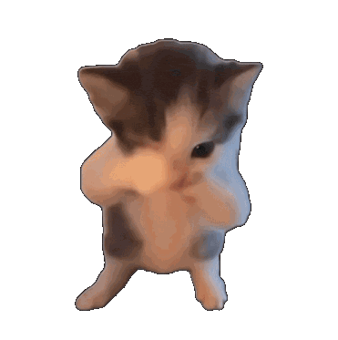

<h1 align="center">Kicau Mania — Dance, Detect, Celebrate</h1>

<p align="center">
  
  <br>
  <em>A real-time desktop dance detector powered by your webcam.
    <br>Cover your mouth, wave your hand, and let the dancing cats take over.</em>
  <br>
</p>

<p align="center">
  <a href="https://github.com/fnilvuwu/Kicau-Mania-Detector"><strong>Kicau Mania Detector</strong></a>
  <br>
</p>

<p align="center">
  <a href="#documentation">Documentation</a>
  ·
  <a href="#installation">Installation</a>
  ·
  <a href="#usage">Usage</a>
  ·
  <a href="https://github.com/fnilvuwu/Kicau-Mania-Detector/issues">Report an Issue</a>
  <br>
  <br>
</p>

<p align="center">
  
  
  
  
</p>

<hr>

## Documentation

Kicau Mania Detector uses MediaPipe hand and face landmarks to recognize the
Kicau Mania dance. When the gesture is detected, it plays music and displays six
synchronized dancing cats inside the camera preview.

- **Fullscreen camera:** the complete image stays centered and proportional,
  with any unused space distributed evenly on opposite sides.
- **Six dancing cats:** four corner GIFs and a pair at the top center, with the
  left cat in each pair mirrored and black backgrounds made transparent.
- **Either hand works:** bring one hand close to your mouth and wave the other.
- **Tracking tolerance:** short interruptions do not immediately reset the gesture;
  sensitivity adjusts to face size, while small landmark jitter is rejected.
- **Optional debug overlay:** inspect landmarks, motion, and detection status
  with `--debug`.

## Installation

Install Python, then open a terminal in the project directory. A webcam and an
internet connection are required for the first run to download the detection models.

### macOS / Linux

```bash
python3 -m venv .venv
source .venv/bin/activate
python -m pip install -r requirements.txt
```

### Windows (PowerShell)

```powershell
python -m venv .venv
.\.venv\Scripts\Activate.ps1
python -m pip install -r requirements.txt
```

## Usage

Start the application with your virtual environment activated:

```bash
python main.py
```

The camera preview opens fullscreen. Keep your face and both hands visible, bring
one hand close to your mouth, and wave the other hand from side to side a few
times. Fingers near the mouth count too. Music and GIFs start when the gesture is
recognized and stop shortly after the gesture ends.

To display detection information on the preview:

```bash
python main.py --debug
```

### Keyboard controls

Click the camera preview to give it keyboard focus.

| Key | Action |
| --- | --- |
| **T** | Test the music and all six GIFs for five seconds. |
| **Q** or **Esc** | Close the application. |

### Assets

The repository includes the music and animation. To customize them, replace the
files at these paths:

| File | Purpose |
| --- | --- |
| `assets/music.mp3` | Music played when a dance is detected. |
| `assets/cat.gif` | Animation shared by all six cats. |

Black areas connected to the GIF's edges are automatically made transparent.
Enclosed dark details, such as the cat's eyes, are preserved.

### Detection models

On the first run, the application downloads these MediaPipe models automatically:

```text
assets/models/hand_landmarker.task
assets/models/face_landmarker.task
```

Later runs reuse the downloaded files. HTTPS downloads use trusted CA certificates
provided by `certifi`.

## Troubleshooting

### Camera access on macOS

If the terminal reports `not authorized to capture video` or
`Failed to open webcam`:

1. Open **System Settings → Privacy & Security → Camera**.
2. Allow access for the application running Python, such as Terminal, iTerm,
   VS Code, or Codex. Choose **Allow** if prompted.
3. Quit and reopen that application, then run `python main.py` again.

If the application is not listed, run the command from Terminal to trigger the
permission request. Also check that a camera is connected and available.

### Gesture is difficult to detect

Keep your face and both hands in view, use even lighting, and wave sideways
several times while keeping the other hand near your mouth. Either hand can
perform either role.

Run `python main.py --debug` to check mouth proximity, visibility of the other
hand, and wave detection. The detector tolerates tracking gaps of up to 0.3 seconds
and keeps the last mouth position for up to 0.8 seconds when face landmarks are
briefly obscured.

To adjust thresholds, hold times, or cooldowns, edit `DetectorConfig` in
[`kicau/config.py`](kicau/config.py).

### Music or GIFs do not appear

Focus the camera preview and press **T** to test playback without performing a
gesture. Check the files under `assets/`, your audio output and volume, and the
terminal for any errors.

### SSL certificate error

If a model download reports `CERTIFICATE_VERIFY_FAILED`, update the certificate
bundle inside your virtual environment:

```bash
python -m pip install --upgrade certifi
```

Check your internet connection and run the application again.

## Development

The application is organized as a Python package. `main.py` only invokes the CLI;
individual modules own detection, playback, rendering, and resource cleanup.

| Module | Responsibility |
| --- | --- |
| [`kicau/config.py`](kicau/config.py) | Application settings, detection thresholds, asset paths, and GIF placements. |
| [`kicau/cli.py`](kicau/cli.py) | Argument parsing; `--help` works without loading the camera or ML libraries. |
| [`kicau/app.py`](kicau/app.py) | Application loop and cleanup of camera, models, audio, and display. |
| [`kicau/detector.py`](kicau/detector.py) | MediaPipe inference, hand selection, and landmark tracking. |
| [`kicau/gesture.py`](kicau/gesture.py) | Gesture state transitions, hold times, tracking grace, and cooldown. |
| [`kicau/motion.py`](kicau/motion.py) | Wave motion analysis. |
| [`kicau/models.py`](kicau/models.py) | Verified model downloads and local cache management. |
| [`kicau/playback.py`](kicau/playback.py) | Timing and coordination of music and GIF playback. |
| [`kicau/audio.py`](kicau/audio.py) | Audio mixer and music playback. |
| [`kicau/animation.py`](kicau/animation.py) | GIF decoding, transparency, and animation frames. |
| [`kicau/rendering.py`](kicau/rendering.py) | Camera centering, debug drawing, and GIF compositing. |
| [`kicau/display.py`](kicau/display.py) | Pygame fullscreen output and keyboard commands. |

To add or reposition GIFs, edit `DEFAULT_OVERLAYS` in `kicau/config.py`. Layout
changes do not require modifying the application loop. `AppConfig` also controls
preview duration, camera index, mirroring, and the asset directory; each instance
has its own `DetectorConfig`.

Both entry points use the same CLI and support `--debug`:

```bash
python main.py
python -m kicau
```

Run the automated tests from the project directory:

```bash
python -m unittest discover -s tests -v
```

To report a bug, include your operating system, Python version, steps to reproduce,
and relevant terminal output in a
[GitHub issue](https://github.com/fnilvuwu/Kicau-Mania-Detector/issues).
